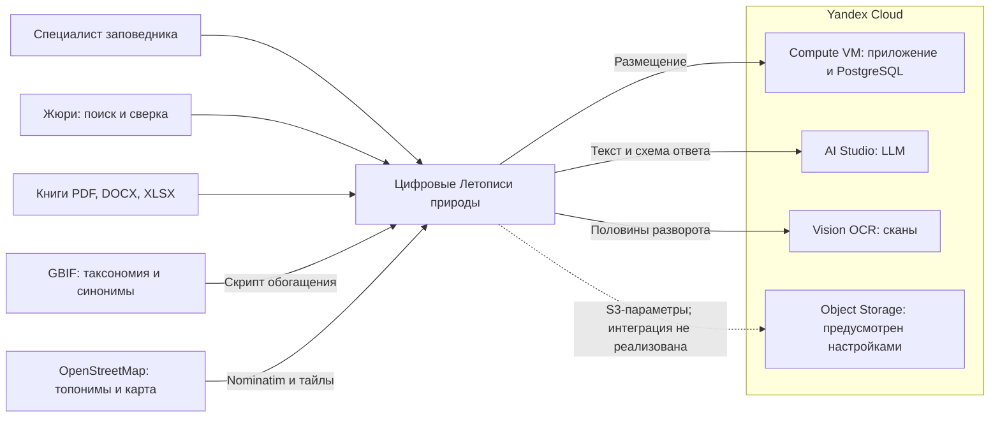
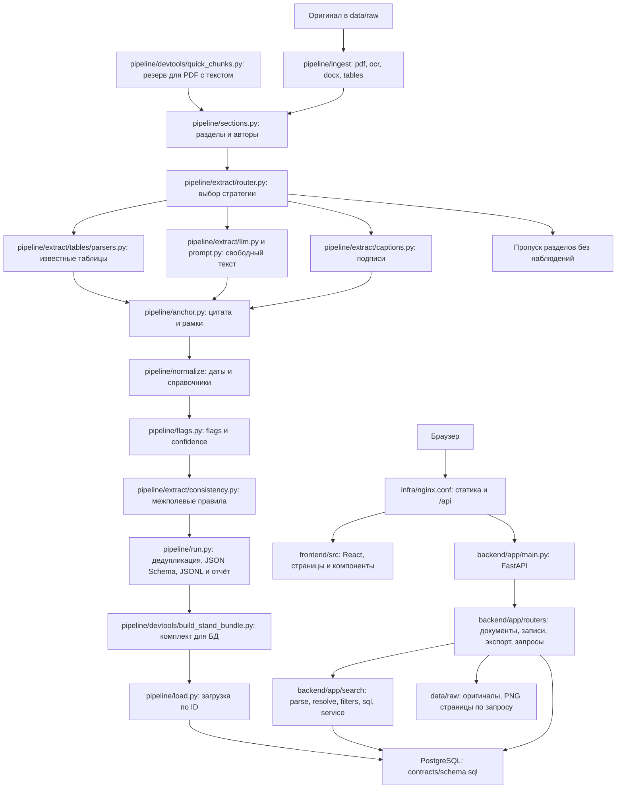
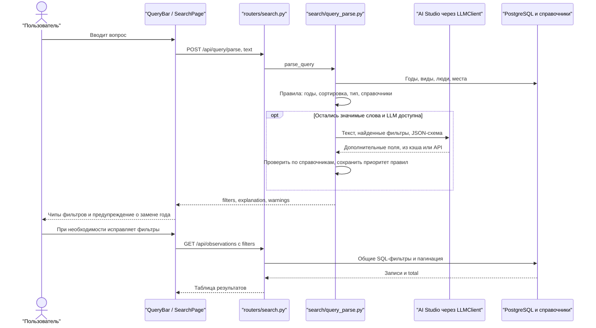
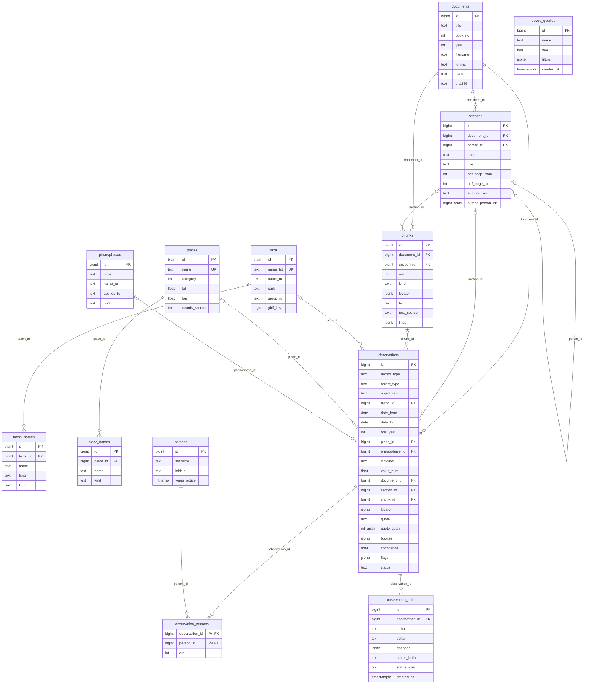

# Архитектура

[Вход в проект](../README.md) · [Данные](DATA.md) · [Развёртывание](DEPLOY.md) · [Демонстрация](DEMO.md)

Описание текущего кода. Состояние стенда на 22.11.2026 приведено по проверенным фактам задания; [задачи](tasks/README.md) описывают дальнейшие работы. Подробности извлечения — в [METHOD](METHOD.md), формальные правила — в [контракте](../contracts/README.md).

## Контекст



Сейчас оригиналы и данные находятся в Docker-томе на VM. `S3_*` есть в Compose, но Object Storage в текущем коде не подключён. GBIF и Nominatim используются скриптами подготовки справочников, не каждым поисковым запросом.

## Компоненты



`pipeline/extract/extractor.py` собирает запись: anchor → нормализация → flags → consistency. `pipeline/run.py` управляет прогоном, кэшем LLM, дедупликацией и проверкой схемы. `build_stand_bundle.py` объединяет результаты с фикстурами и координатами строк; `load.py` вставляет их в БД, сохраняя существующие ID и ручные правки.

FastAPI применяет SQL-схему при старте через [db.py](../backend/app/db.py). Поиск и экспорт используют общие фильтры; `resolve.py` сопоставляет названия, `sql.py` строит условия, `service.py` выполняет поиск. Во фронтенде [SearchPage](../frontend/src/pages/SearchPage.tsx) управляет выдачей, [ObservationPanel](../frontend/src/components/ObservationPanel.tsx) — карточкой, [SourceView](../frontend/src/components/SourceView.tsx) — цитатой и подсветкой. Фильтры сохраняются в URL.

Загрузка через UI сохраняет файл со статусом `queued`. [pipeline/ingest/jobs.py](../pipeline/ingest/jobs.py) только журналирует очередь: автоматический воркер полного цикла ещё не подключён. Обработка текущих книг выполняется CLI, результаты доставляются через `release/`.

## Одна запись: от PDF до подсветки

```mermaid
sequenceDiagram
    participant cli as "Оператор CLI"
    participant ingest as "pipeline/ingest"
    participant core as "pipeline/run и extractor"
    participant model as "Правила или LLM"
    participant anchor as "anchor и normalize"
    participant db as "PostgreSQL"
    participant api as "FastAPI"
    participant ui as "React / SourceView"
    cli->>ingest: PDF и document_id
    alt Есть текстовый слой
        ingest->>ingest: Текст, строки, таблицы и координаты
    else Страница сканирована
        ingest->>ingest: OCR половин разворота, координаты всей страницы
    end
    ingest-->>core: chunks и lines; locator.pdf_page
    core->>core: Раздел, авторы, стратегия
    core->>model: Фрагмент с контекстом
    model-->>core: Поля и обязательная цитата
    core->>anchor: Найти цитату в chunk.text
    anchor-->>core: Дословная quote, quote_span, bboxes, нормализованные поля
    core->>core: Флаги, confidence, consistency, JSON Schema
    core-->>cli: observations JSONL и отчёт
    cli->>db: build_stand_bundle, затем load.py
    ui->>api: GET /api/observations с фильтрами
    api->>db: Поиск и labels
    api-->>ui: Строки таблицы
    ui->>api: Клик: GET /api/observations/{id}
    api-->>ui: observation, chunk, section, document, edits
    ui->>api: GET /api/documents/{id}/pages/{n}.png
    api-->>ui: Изображение страницы PDF
    ui->>ui: Наложить bboxes; открыть оригинал через file и #page=n
```

`quote_span` — полуоткрытый интервал символов Python Unicode: `chunk.text[start:end] == quote`. `bboxes` — доли 0…1 от **всей** страницы PDF, включая разворот; `half=L/R` указывает половину. При нормализованном/нечётком совпадении сохраняется дословный текст источника. Не нашли цитату — `quote_span=null`, `bboxes=[]`, флаг `quote_not_found`. Без координат строк точность подсветки ограничена рамкой фрагмента. Правила — [«Решения», пп. 3–5, 17, 21](../contracts/README.md#решения-сверх-spec-и-там-где-spec-неполон).

## Запрос обычными словами



Четыре приёмочных запроса покрываются правилами. Без ключа или при `LLM_BACKEND=mock` остаются правила; нераспознанные слова видны в предупреждениях. «Лось за 2022 год» даёт предупреждение «2022 → 2020: книги за 2022 год нет». `years` означает годы наблюдения, `doc_years` — годы книг. Разбор не выполняет произвольный SQL от LLM.

## База данных

Все 13 таблиц из [contracts/schema.sql](../contracts/schema.sql); показаны ключи и основные поля. `FK` — именно SQL-ссылка. `sections.author_person_ids` — массив без отдельного FK; `observations.person_ids` существует в API, в SQL используется таблица связей.



Составные UNIQUE: `chunks(document_id, ord)`, `taxon_names(taxon_id, name)`, `place_names(place_id, name)`, `persons(surname, initials)` с `NULLS NOT DISTINCT`, `phenophases(applies_to, code)`. `saved_queries.filters` — JSONB, внешних ключей нет. Индексы pg_trgm служат поиску по названиям и исходному тексту; для кириллицы нужна подходящая локаль. PostgreSQL — 16+.

## API

Параметры и схемы — [openapi.yaml](../contracts/openapi.yaml). Ниже текущие маршруты и отдельно пробел контракта.

| Метод | Путь | Назначение | Модуль-обработчик |
|---|---|---|---|
| GET | `/api/health` | Состояние сервиса и БД | `backend/app/main.py` |
| GET | `/api/observations` | Поиск, сортировка, страницы | `routers/search.py` → `search/service.py` |
| POST | `/api/query/parse` | Текст → фильтры, объяснение, предупреждения | `routers/search.py` → `search/query_parse.py` |
| GET | `/api/observations/{id}` | Запись, источник, история | `routers/observations.py` |
| PATCH | `/api/observations/{id}` | Исправить, подтвердить, отклонить | `routers/observations.py` |
| GET | `/api/export` | XLSX/CSV с теми же фильтрами | `routers/export.py` |
| GET | `/api/phenology` | Фенофаза × год | `routers/search.py` → `search/phenology.py` |
| GET | `/api/places/{id}/species` | Виды и число записей в месте | `routers/search.py` → `search/places.py` |
| GET | `/api/suggest/{kind}` | Подсказки: taxa, places, persons, phenophases | `routers/search.py` → `search/suggest.py` |
| GET | `/api/documents` | Документы и статусы | `routers/documents.py` |
| POST | `/api/documents` | Сохранить оригинал, вернуть `queued` | `routers/documents.py`; `pipeline/ingest/jobs.py` — заглушка воркера |
| GET | `/api/documents/{id}/file` | Оригинал | `routers/documents.py` |
| GET | `/api/documents/{id}/pages/{n}.png` | Рендер PDF-страницы, номера с 1 | `routers/documents.py` |
| GET | `/api/saved-queries` | Список запросов | `routers/queries.py` |
| POST | `/api/saved-queries` | Сохранить имя, текст и фильтры | `routers/queries.py` |
| DELETE | `/api/saved-queries/{id}` | Удалить запрос | `routers/queries.py` |
| GET | `/api/quality` | Предусмотрен контрактом; в приложении отсутствует, на стенде 404 | Обработчик не подключён, [B-5](tasks/B-5.md) |

`routers/` и `search/` в таблице относятся к `backend/app/`. `GET /api/places` также ещё не реализован и не внесён в OpenAPI; не путать с `/api/places/{id}/species`. Служебные страницы FastAPI `/docs`, `/redoc`, `/openapi.json` не являются бизнес-API.

Внутри массива фильтра действует ИЛИ, между полями — И; даты пересекаются интервалами. По умолчанию `rejected` исключены из поиска и выгрузки. PATCH пишет `old/new`, проверяющего и смену статуса в `observation_edits`, источник неизменяем.

## Ключевые решения

| Решение | Зачем | Основание |
|---|---|---|
| Дословная цитата и координаты | Проверка значения по оригиналу, обнаружение отсутствия опоры | [Контракт, правила 3–4 и решения 3, 17, 21](../contracts/README.md) |
| Кэш LLM по модели, версии промпта и сообщениям | Пересборка с сохранёнными ответами без новых платных вызовов; изменённый вход создаёт другой ключ | [METHOD, раздел 4](METHOD.md#4-llm-со-схемой-и-обязательной-цитатой), `pipeline/extract/llm.py`; формат результата — [контракт](../contracts/README.md) |
| Правила для известных таблиц | Сохраняют годы столбцов и каждую числовую ячейку, уменьшают число LLM-вызовов | [METHOD](METHOD.md), раздел 3; [решения 6–8](../contracts/README.md) |
| Справочники плюс исходные `*_raw` | Объединяют синонимы, сохраняя формулировку и неоднозначности | [Решения 2, 6, 14, 23](../contracts/README.md) |
| Флаги и эвристический `confidence` | Приоритет ручной проверки; это не измеренная вероятность правильности | [Правило 3](../contracts/README.md), [METHOD, раздел 7](METHOD.md#7-флаги-и-достоверность) |
| Единый контракт | Согласует JSONL, БД, API, UI и экспорт; валидатор проверяет совместимость | [Контракт: файлы, правила 1–2, решения 18–20](../contracts/README.md) |

Числа качества, стоимости и ограничения — в [DATA](DATA.md).
