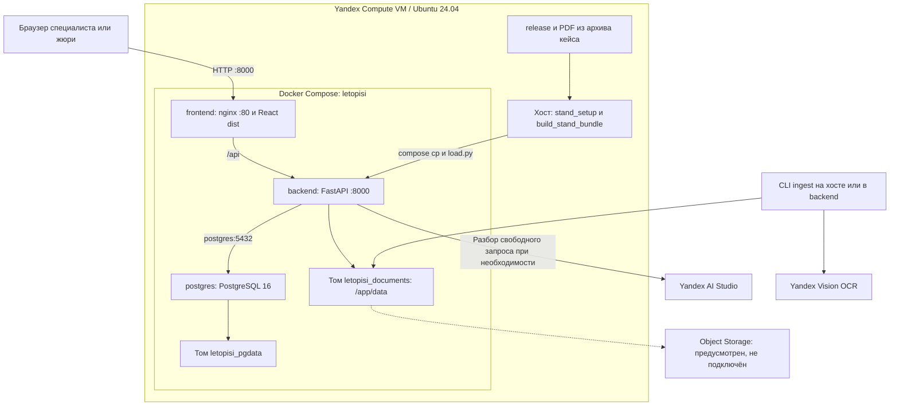

# Развёртывание

[Вход в проект](../README.md) · [Архитектура](ARCHITECTURE.md) · [Данные](DATA.md) · [Показ](DEMO.md)

Стенд: http://51.250.9.93:8000/ — Yandex Compute VM, Ubuntu 24.04. По проверке из задания на 22.11.2026 доступен из РФ, через некоторые VPN не открывается. Команды ниже — Bash (Linux/WSL/Git Bash); локальные команды Docker также работают в PowerShell.

## Локально

Нужны Docker, Compose v2, BuildKit и доступ к образам и npm при первой сборке.

```sh
# Из корня репозитория
cp infra/.env.example infra/.env
cd infra
docker compose up -d --build --wait
docker compose exec -T backend python pipeline/load.py
curl -fsS http://localhost:8000/api/health
```

Ожидаемый ответ: `{"status":"ok","db":true,"version":"1.0.0"}`. Откройте http://localhost:8000/. По умолчанию загрузятся 38 записей фикстур; повторная загрузка тех же ID не добавляет строк и сохраняет правки. Фикстуры не равны полной базе стенда.

Положите оригиналы в `data/raw/`: `book02_1995.pdf`, `book03_1996.pdf`, `book27_2020.pdf`, а таблицу параметров — `parameters_2020.xlsx`. Из `infra/` скопируйте оригиналы в контейнер:

```sh
docker compose cp ../data/raw/. backend:/app/data/raw/
```

API возвращает оригинал из `/app/data/raw/<id>/` или `/app/data/raw/`. PNG нужной страницы рендерится из PDF по запросу; наличие заранее подготовленных PNG не заменяет оригинал для этого обработчика.

`docker compose down` останавливает стек, сохраняя данные. Том `letopisi_pgdata` хранит PostgreSQL, `letopisi_documents` — `/app/data`. Для обычного обновления не удаляйте тома.

## Настройки

| Переменная | Для чего |
|---|---|
| `POSTGRES_PASSWORD` | Пароль роли `letopisi` при создании БД |
| `DATABASE_URL` | В контейнере: `postgresql+psycopg://letopisi:<пароль>@postgres:5432/letopisi`; с хоста — `127.0.0.1` |
| `LLM_BACKEND` | `mock` — разбор запросов правилами без облака; `yandex` — разрешить LLM |
| `YC_FOLDER_ID`, `YC_API_KEY` | Каталог и ключ Yandex Cloud для LLM/OCR; ключи не нужны для чтения готового `release/` |
| `DATA_DIR` | В Compose фиксирован `/app/data`; файлы API и ingest |
| `S3_BUCKET`, `S3_ACCESS_KEY`, `S3_SECRET_KEY` | Предусмотренные параметры Object Storage; текущий код использует локальный том |

Образец — [infra/.env.example](../infra/.env.example). Пароль задаётся согласованно в двух первых переменных; специальные символы в URL кодируются. Изменение `.env` требует пересоздания контейнера; смена `POSTGRES_PASSWORD` сама по себе не меняет пароль в существующем томе БД.

CLI ядра дополнительно читает `LLM_MODEL`, `LLM_CACHE_DIR`, `LLM_CONCURRENCY`, `LETOPISI_DATA_DIR`, `LETOPISI_RAW_DIR`. Compose не передаёт их автоматически. Полный CLI-прогон выполняйте на хосте с Python 3.12 и зависимостями из [README](../README.md#проверки); backend-образ не включает все CLI-модули. Для `build_stand_bundle` используйте стандартный `data/` — он не читает `LETOPISI_DATA_DIR`. Подробности извлечения — [METHOD](METHOD.md).

## Стенд на чистой VM

1. Создайте Ubuntu 24.04 VM в Yandex Cloud, настройте SSH и входящий TCP 8000. PostgreSQL в Compose опубликован только на `127.0.0.1:5432`.
2. Установите git при необходимости, клонируйте репозиторий и передайте архив книг кейса:

```sh
sudo apt-get update
sudo apt-get install -y git
git clone https://github.com/leksika1/letopisi.git ~/letopisi
cd ~/letopisi
bash infra/stand_setup.sh ~/case.zip
```

3. Первый запуск [stand_setup.sh](../infra/stand_setup.sh) устанавливает Docker/Compose, создаёт `infra/.env` со случайным паролем и останавливается, если `YC_API_KEY` пуст. Откройте `nano infra/.env`, впишите ключ, проверьте свой `YC_FOLDER_ID` (скрипт подставляет каталог стенда), оставьте `LLM_BACKEND=yandex`:

```sh
chmod 600 infra/.env
bash infra/stand_setup.sh ~/case.zip
```

4. Скрипт распаковывает `release/book27_2020`, собирает `data/stand_bundle`, извлекает PDF из архива по году в имени, поднимает Compose, копирует комплект и PDF в контейнер, вызывает `load.py` и `/api/health`.
5. Проверьте главную страницу, выдачу и источник PDF стр. 499. Без архива сервис поднимется, но оригиналы нужно добавить вручную. Скрипт извлекает только PDF, XLSX параметров при необходимости кладётся отдельно.

Для установки из готового `release/` достаточно штатного Python VM: `build_stand_bundle` использует стандартную библиотеку. Если на хосте планируются новое извлечение или оценка качества, отдельно подготовьте окружение Python 3.12:

```sh
sudo apt-get install -y python3-venv
python3 -m venv .venv
. .venv/bin/activate
python -m pip install -r backend/requirements-dev.txt -r pipeline/ingest/requirements.txt
```

### Если Docker Hub недоступен

Скрипт добавляет `https://mirror.gcr.io` и `https://dockerhub.timeweb.cloud` в `registry-mirrors`, **только если** `/etc/docker/daemon.json` ещё не существует, затем перезапускает Docker. Если файл уже есть, сохраните настройки и добавьте зеркала вручную в его JSON, затем выполните `sudo systemctl restart docker`. Наличие зеркал не гарантирует доступность каждого образа. Если новая группа Docker ещё не действует, скрипт использует `sudo docker`.

### Если VM не может скачать npm-пакеты

[infra/frontend.Dockerfile](../infra/frontend.Dockerfile) использует `frontend/dist`, если там есть `index.html`; тогда `npm ci` и сборка пропускаются. Готовая статика предусмотрена в ветке `stand-dist`. Для новой VM можно клонировать её вместо обычной ветки:

```sh
git clone --branch stand-dist https://github.com/leksika1/letopisi.git ~/letopisi
```

Для уже клонированной копии возьмите только сборку и убедитесь, что она соответствует разворачиваемой версии:

```sh
git fetch origin stand-dist
git restore --source=FETCH_HEAD -- frontend/dist
test -f frontend/dist/index.html
bash infra/stand_setup.sh ~/case.zip
```

Вариант — собрать `npm ci && npm run build` в `frontend/` на машине с доступом к npm и передать `dist/` на VM. Node-образ, nginx, Python-образ и Python-зависимости всё равно должны быть доступны: готовый `dist` устраняет только скачивание npm-пакетов.

## Загрузка полной базы без нового LLM-прогона

Из корня на хосте с Python 3.12 и установленными зависимостями:

```sh
mkdir -p data/observations data/chunks data/sections
for f in release/book27_2020/*.jsonl.gz release/book27_2020/*.json.gz; do
  n=$(basename "$f" .gz)
  dir=${n%%_*}
  gunzip -c "$f" > "data/$dir/${n#*_}"
done
python -m pipeline.devtools.build_stand_bundle --out data/stand_bundle
cd infra
docker compose cp ../data/stand_bundle backend:/app/data/stand_bundle
docker compose exec -T backend python pipeline/load.py /app/data/stand_bundle
```

`stand_setup.sh` уже делает эти шаги. `build_stand_bundle` заменяет фикстуры обработанных документов результатами ядра, переносит `lines` и авторов разделов, удаляет неприменимые истории фикстур. Справочники и запросы берёт из `contracts/fixtures`. При повторном копировании проверьте, что файлы лежат прямо в `/app/data/stand_bundle`, не во вложенном `stand_bundle/`.

Для повторного извлечения дополнительно восстановите кэш (для импорта в БД он не нужен):

```sh
# Снова из корня репозитория
tar -xzf release/book27_2020/llm_cache.tar.gz -C data
```

Имена файлов и числа — в [DATA](DATA.md#состав-release). Загрузчик вставляет отсутствующие ID, но не обновляет существующие: пересборка с теми же ID не заменит записи на стенде. Для замены ранее загруженной выборки нужен отдельный перенос правок и обновление данных; повторного `load.py` недостаточно. Обогащённые `dictionaries/*.csv` пока не загружаются в БД ([B-5](tasks/B-5.md)).

## Обновление стенда

Для VM, установленной через `stand_setup.sh`, обновляйте код в том же клоне. Перед обновлением сохраните резервную копию БД из `infra/`:

```sh
docker compose exec -T postgres pg_dump -U letopisi -d letopisi > ../letopisi-before-update.sql
```

В корне обновите нужную ветку (`git pull --ff-only`), при использовании готовой статики обновите соответствующий `dist`, затем из `infra/`:

```sh
docker compose up -d --build --wait
docker compose ps
curl -fsS http://127.0.0.1:8000/api/health
```

Если появились новые результаты, пересоберите комплект и загрузите его по инструкции выше. Новые PDF копируются отдельно. Проверьте поиск, подсветку, экспорт; числа результатов сверяйте с текущей базой, а не тестовым снимком.

Альтернативный способ — [infra/deploy.sh](../infra/deploy.sh), с машины с Bash, SSH и rsync:

```sh
bash infra/deploy.sh user@vm
```

Он передаёт выбранные файлы кода и готовый `dist`, если есть, в новый `~/letopisi/releases/deploy.*`, собирает контейнеры и переключает `~/letopisi/current`. `.env` для этого способа находится в `~/letopisi/.env`; при переходе со `stand_setup` подготовьте его из `~/letopisi/infra/.env` с правами 600. Имя Compose-проекта и тома сохраняются. Скрипт **не передаёт** `data/` и `release/`, не запускает полный pipeline и не загружает данные автоматически. Не смешивайте каталоги `.env` двух способов установки.

## Схема деплоя



Путь от хостового ingest к тому означает отдельное копирование файлов; ingest внутри backend пишет сразу в `/app/data`. Полный `pipeline.run` и сборка комплекта выполняются на хосте.
